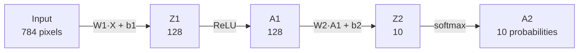
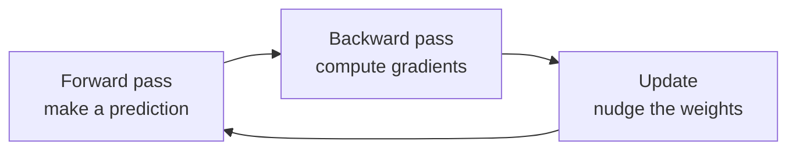
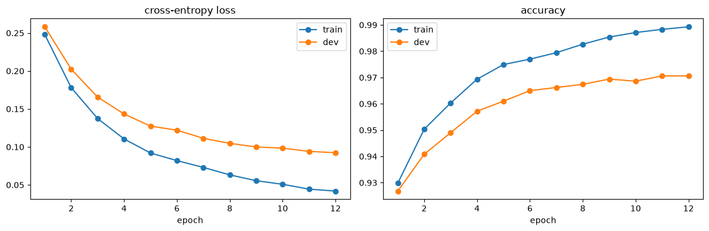
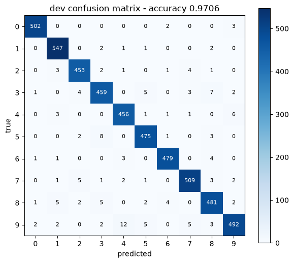
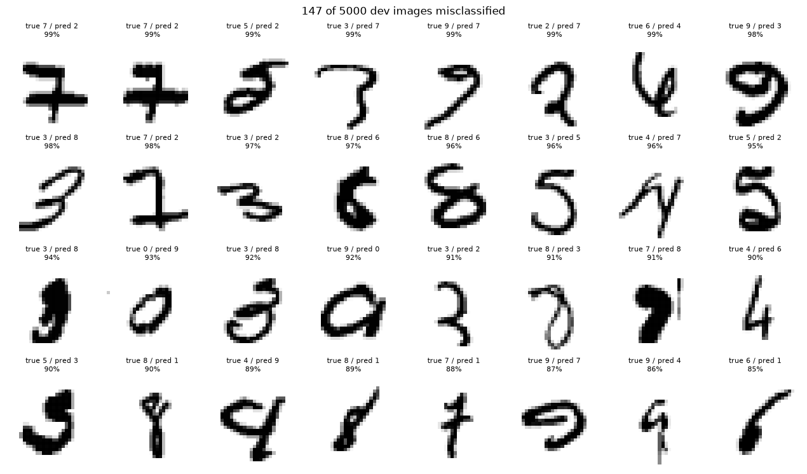

I use AI tools every day, and I wanted to really understand what's happening underneath them. So I did the classic exercise: train a neural network to recognize handwritten digits using only NumPy. No PyTorch, no TensorFlow, no autograd. Every gradient is worked out by hand.  

I built it at home on a macbook and it got to **97% accuracy** on digits it had never seen.

The code is on GitHub: [mshimer/mike-mnist](https://github.com/mshimer/mike-mnist).

<!--more-->

## The problem

[MNIST](https://en.wikipedia.org/wiki/MNIST_database) is the "hello world" of machine learning: 70,000 grayscale images of handwritten digits, each 28x28 pixels. The job is to look at an image and say which digit (0-9) it is.

Each image is flattened into a column of 784 numbers (28 x 28), one per pixel. I split the data like this:

| Set | Examples | Used for |
|---|---|---|
| Train | 55,000 | Learning the weights |
| Dev | 5,000 | Checking progress after each epoch |
| Test | 10,000 | Held back |

## The network

The network is small: one hidden layer of 128 neurons, and an output layer of 10 neurons, one per digit. That works out to about 100k parameters.



- **ReLU** on the hidden layer: `max(0, z)`. It's simple and it's what gives the network its non-linearity.
- **Softmax** on the output turns 10 raw scores into 10 probabilities that sum to 1.
- **He initialization** for the weights (random values scaled by $\sqrt{2/n}$), which works well with ReLU.

## Training: three steps, over and over

Training a neural network is a loop of three steps.



### 1. Forward pass

Push a batch of images through the network to get predictions:

$$Z^{[1]} = W^{[1]}X + b^{[1]} \qquad A^{[1]} = \text{ReLU}(Z^{[1]})$$

$$Z^{[2]} = W^{[2]}A^{[1]} + b^{[2]} \qquad A^{[2]} = \text{softmax}(Z^{[2]})$$

In NumPy it's four lines:

```python
def forward_pass(W1, b1, W2, b2, X):
    Z1 = W1.dot(X) + b1
    A1 = ReLU(Z1)
    Z2 = W2.dot(A1) + b2
    A2 = softmax(Z2)
    return Z1, A1, Z2, A2
```

### 2. Backward pass (backpropagation)

This is the part frameworks hide from you. You work out how much each weight contributed to the error, starting at the output and moving backward with the chain rule. Softmax combined with cross-entropy loss gives a nice result: the output error is just *prediction minus truth*.

$$dZ^{[2]} = A^{[2]} - Y$$

$$dW^{[2]} = \tfrac{1}{m}\, dZ^{[2]} A^{[1]T} \qquad dZ^{[1]} = W^{[2]T} dZ^{[2]} \odot \text{ReLU}'(Z^{[1]})$$

$$dW^{[1]} = \tfrac{1}{m}\, dZ^{[1]} X^{T}$$

```python
def back_prop(Z1, A1, Z2, A2, W2, X, Y):
    m = X.shape[1]
    dZ2 = A2 - Y
    dW2 = 1 / m * dZ2.dot(A1.T)
    dB2 = 1 / m * np.sum(dZ2, axis=1, keepdims=True)
    dZ1 = W2.T.dot(dZ2) * deriv_ReLU(Z1)
    dW1 = 1 / m * dZ1.dot(X.T)
    dB1 = 1 / m * np.sum(dZ1, axis=1, keepdims=True)
    return dW1, dB1, dW2, dB2
```

One of my favorite lines: the derivative of ReLU is just `Z > 0`. The boolean gets coerced to 1 or 0.

### 3. Update

Gradient descent: step each weight a little in the direction that reduces the error.

$$W = W - \alpha \, dW$$

I used a learning rate $\alpha$ of 0.1, mini-batches of 64 images, and 12 epochs (full passes over the training data).

## Results

After 12 epochs the model got **97.06% accuracy on the dev set**.



The train and dev curves stay close together, which means the model is learning patterns that generalize instead of memorizing the training data. The gap starts to open up a bit toward the end. More epochs would probably start to overfit.

### Where it gets confused

A confusion matrix shows what the model predicted against the true label. A strong diagonal means mostly correct answers:



The most interesting chart is the mistakes - 147 of the 5,000 dev images, sorted by how *confident* the model was in its wrong answer:



Honestly, I'd get a few of these wrong too. A 7 with a heavy crossbar does look like a 2, and some of those 3s and 8s are tough.

## What I learned

- **It's all math.** A neural network is matrix multiplication, a simple non-linearity, and the chain rule. Once you've written backprop by hand, `loss.backward()` in PyTorch stops being a black box.
- **Shapes are everything.** Most of my bugs were shape bugs. Writing the expected shape next to every line (`(128, 784) · (784, m) = (128, m)`) helps visualize what is going on, and understand how the layers/tensors fit together.


## Resources

These are all great resources.  Advice : Code along with the videos.

- [3Blue1Brown - Neural Networks](https://www.youtube.com/watch?v=aircAruvnKk&list=PLZHQObOWTQDNU6R1_67000Dx_ZCJB-3pi) - the best visual intuition for what's going on
- [Andrej Karpathy - Neural Networks: Zero to Hero](https://www.youtube.com/watch?v=VMj-3S1tku0&list=PLAqhIrjkxbuWI23v9cThsA9GvCAUhRvKZ) - building it all from scratch
- [Building a neural network from scratch (NumPy)](https://www.youtube.com/watch?v=w8yWXqWQYmU)

The whole thing fits in one notebook: [mike-mnist on GitHub](https://github.com/mshimer/mike-mnist).
